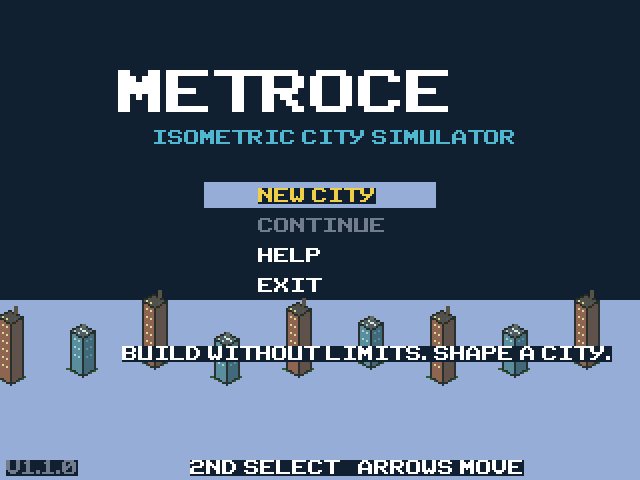
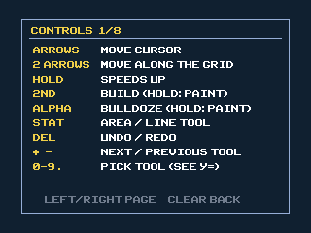
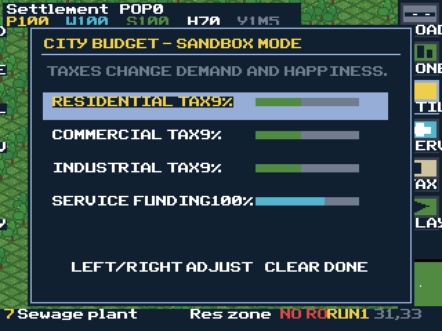
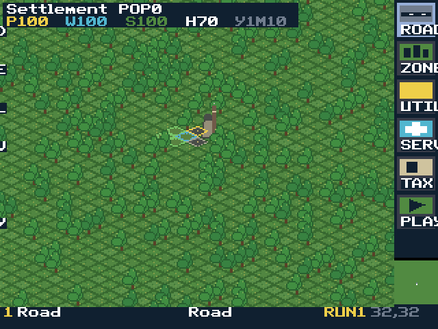

# MetroCE V1.3.0

MetroCE is an original isometric city-building sandbox for the **TI-84 Plus CE / CE-T**, including the CE-T Python Edition. Its visual direction is inspired by classic isometric city simulators: diamond terrain, pixel-art towers, trees, roads, traffic, a construction sidebar, and a minimap.

**Sandbox mode has unlimited money.** The challenge comes from designing a functioning city rather than managing a cash balance.

New here? Read [TUTORIAL.md](TUTORIAL.md), or press `Mode` in the game for the built-in help and tutorial.

## Screenshots

Captured in CEmu during testing.

| Main menu | Controls help |
|---|---|
|  |  |

| Budget | A loaded city |
|---|---|
|  |  |

These four were taken on earlier builds. The loaded-city shot predates the sidebar-label fix (the stray letters at the left edge are gone in V1.2.1 and later), and the road art, zoom and cars are newer than all four.

## Play

1. Build `METROCE.8xp` or use the prebuilt file in `bin/`.
2. Transfer it to the calculator with TI Connect CE or another compatible link program.
3. On an Artifice-enabled CE-T, open the program menu and run `METROCE` (use the `Asm(` token if the calculator inserts it).
4. Start a new city or continue the saved `METROSAV` AppVar.

## Controls

| Key | Action |
|---|---|
| Arrow keys | Move the cursor in the direction you press (screen-aligned), one cell per step |
| Two arrows at once | Diagonal = move along the map grid (use this for straight roads) |
| Hold an arrow | Auto-repeat, then speeds up (1, 2, then 3 tiles per step) |
| `2nd` | Build the selected item. Hold while moving to paint |
| `Alpha` | Bulldoze. Hold while moving to paint |
| `Stat` | Area / line tool: mark a corner, move, then `2nd` builds, `Alpha` clears, `Clear` cancels |
| `Stat` (again) | Road tool only: flip the L-shaped line |
| `Del` | Undo / redo your last stroke |
| `1`-`9`, `0`, `.` | Pick a tool directly (shown in the `Y=` menu) |
| `+` / `-` | Next / previous tool |
| `Y=` | Construction menu |
| `Window` | Tax and service-funding panel (hold Left/Right to repeat) |
| `Zoom` | Save to the `METROSAV` AppVar |
| `Trace` | Pause / resume (resumes at the speed you left) |
| `Graph` | Cycle simulation speed |
| `Enter` | City statistics and RCI demand. Right: the goals list |
| `Math` | Zoom close / wide (starts close) |
| `Mode` | Help and tutorial (9 pages, Left/Right to flip) |
| `Clear` | Press twice to save and exit |

The bottom bar shows the active tool and its number key, what is under the cursor (zones with no road show a red NO ROAD), the simulation speed, and the cursor coordinates.

## Simulation systems

- 64×64 scrolling isometric map
- Residential, commercial, and industrial zoning
- Three development densities per zone
- Road-access requirements
- Electricity, water, and sewage capacity
- Separate RCI tax rates and adjustable service funding
- Parks, police, fire, and schools with local coverage areas
- Industrial and power-plant pollution
- Population, jobs, unemployment, happiness, and RCI demand
- Growth, upgrading, and abandonment
- Moving traffic: cars drive the roads that serve buildings, and congested streets lower happiness
- Fires that burn buildings down unless a fire station covers them
- Ten goals to chase (citizens, roads, happiness, employment, services, level-3 buildings)
- Persistent AppVar save

This is a compact calculator interpretation, not a full Cities: Skylines or SimCity simulation. Utilities use citywide capacity rather than pipe/power-line networks. Congestion is only felt next to homes: a street over 60% costs adjacent homes 5 happiness, over 90% costs 10.

## Build from source

Install [CEdev](https://ce-programming.github.io/toolchain/), ensure `cedev-config` is on `PATH`, then run:

```sh
python3 tools/make_assets.py  # only needed if regenerating artwork; requires Pillow
make gfx
make
```

The generated sprites and convimg configuration are included, so Pillow is not required for a normal build. Output appears in `bin/METROCE.8xp`. Built and checked against CEdev v15.0.

### Tests

`tests/run.sh` compiles the input, area, undo and cursor-movement logic on your computer (needs `gcc`, not CEdev) against a stubbed keypad. It includes a brute-force check of the visible-tile culling against thousands of random camera positions. It does not run the calculator build.

## Changelog

**V1.3.0** (look and gameplay)
- **Roads now connect.** New road art runs from tile centre to the exact edge midpoints, so neighbouring roads join into continuous streets with proper junctions.
- **Closer camera.** The world starts zoomed in (32x16 tiles, native 2x sprites). `Math` switches back to the wide view. Zoom data adds about 59 KB to the program.
- **Traffic.** Up to 20 cars drive the roads that serve buildings. They are small coloured blocks drawn above the map and never trigger a full redraw. Busy streets also cost adjacent homes happiness.
- **Fires.** Once a city has 60 people, fires start now and then. A fire station in range puts them out; otherwise the building drops to an empty zone.
- **Goals.** Ten goals with progress, a toast when one is completed, and a goals page on the `Enter` screen.
- **Start-up screen** (placeholder): a skyline grows and the logo appears; any key skips it.
- README screenshots added from `docs/screenshots`.

**V1.2.2** (menu backdrop)
- Construction, Budget and City Data panels now draw over the current game view instead of leftover title-screen pixels.

**V1.2.1** (hardware fixes, from photos on a TI-84 Plus CE-T)
- **Every tile can now be selected.** A single arrow used to move two grid cells at once, which kept x+y constant and made half the map (a checkerboard) unreachable without two-arrow chords. A single arrow now moves one cell, alternating between the two grid axes, so two presses travel the old distance and any tile can be reached.
- The cursor was drawn at its old position on frames where the camera re-centred, leaving stray yellow diamonds. Fixed.
- Sidebar labels ran past the screen edge and wrapped onto the left edge of the next row. They are now centred inside the sidebar; the paused label is HOLD.

**V1.2.0** (performance)
- Based on CEmu profiling of V1.1.1: an empty-city frame took about 637 ms, nearly all of it drawing the map, which also throttled input.
- The map is now drawn into an off-screen buffer and only the changed rectangles are copied to the screen. Moving the cursor, painting and small simulation changes no longer redraw the map.
- **The camera no longer follows the cursor every step.** The cursor moves on screen and the view recentres when it nears the edge.
- Tiles are culled before drawing (only visible diagonals and columns are visited), sprites are RLET, the minimap is a cached sprite, and frames with nothing to show are skipped.
- Held arrows catch up on steps skipped during a slow frame (bounded at 3, not while painting).
- Traffic dots no longer animate every frame; they update when tiles are redrawn.
- Full redraws still happen on scroll, menu exit, and when many visible tiles change at once, and are expected to take a few hundred ms.

**V1.1.1** (layout fix)
- Construction menu: only the selected tool's description is shown, on its own line, so the two columns no longer overlap. Title screen tagline and footer got solid backing so they no longer sit on the skyline art.

**V1.1.0** (controls)
- Arrows now move in the screen direction; diagonal chords move along the grid.
- Tap moves exactly one step; hold repeats after a short delay and accelerates.
- Painting keeps the trail 4-connected, so roads never touch only at corners.
- Area / line tool, one-level undo / redo, number-key tool select, `+` / `-` tool cycling.
- Cursor inspector and NO ROAD warning in the bottom bar; message when a tile is in use.
- Menus repeat when held (budget values were 1 tap per step). Fixed the construction menu jumping to a non-existent tool when pressing Right on Water tower.
- Simulation now ticks on the clock instead of per frame, so input responsiveness no longer changes game speed.
- Pause resumes at the previous speed. Year counter now advances. `Clear` needs a second press to exit.
- Built-in help is 8 pages: controls plus a tutorial of how the simulation works.

**V1.0.0** original release (version assumed; the uploaded source carried no version number).

## Artwork

All tile and building artwork is original procedural pixel art generated by `tools/make_assets.py`. No artwork was extracted from the reference screenshot or from a commercial game.
